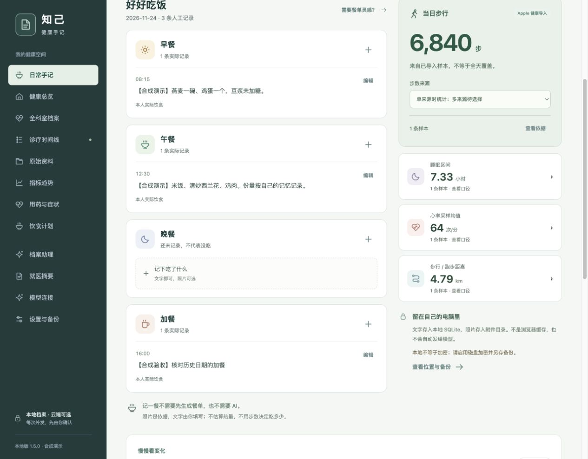
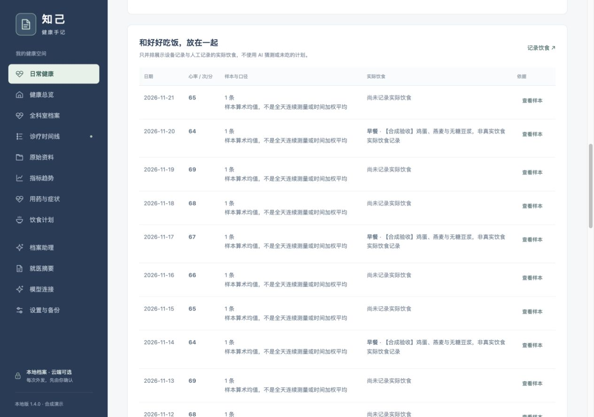
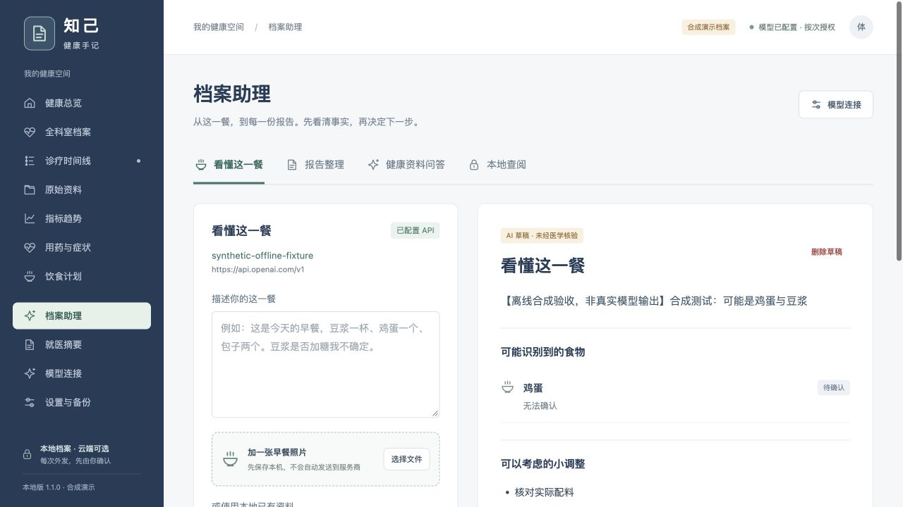

# 知己 · 健康手记

**本地优先、中文界面的个人健康档案。记录事实，保留依据。**

把散落的就诊、检查、用药、症状与日常饮食放在同一个个人档案里。无需账号、无需云端、无需前端构建；Python 标准库 + SQLite，零第三方运行时依赖。

**v1.1 新增：可选 API 大模型、餐食图文分析、报告整理草稿、55 个常见科室目录和多科关联。** 核心档案仍可完全离线使用；云端分析必须逐次确认，不等于资料自动上传。

当前源码版本 **1.5.0** · MIT 许可 · 单人本地优先 · 开发预览。新增 **日常手记：按天统一 Apple 步行/休息与实际饮食，直接记一餐、关联照片、编辑和备份**，不需要先生成餐单或调用 AI。支持 Apple 健康官方 ZIP/XML 本地导入，不是 Apple ID 登录或实时 HealthKit 同步。默认仍为空白。见 [日常手记](docs/DAILY_JOURNAL.md)、[Apple 导入](docs/APPLE_HEALTH.md)、[本轮设计研究](docs/research/2026-11-25-daily-journal-ux.md) 和 [验收范围](docs/ACCEPTANCE-v1.5.0.md)。不作为唯一医疗资料副本。



> **医疗与安全边界：** 本项目未按医疗器械用途设计或验证，不声称获得任何监管批准。它不确诊、不预测患病概率、不开处方、不调整用药，不以 AI 建议替代医生。**桌面**数据库、附件和 ZIP 未做应用层加密、无密码锁；**手机资料版**加密保存于浏览器，但清理站点数据可能丢失，忘记密码无法找回。测试通过不代表零 Bug、不会泄露或医学判断正确。
>
> 使用前请阅读：[详细医疗免责声明](DISCLAIMER.md) · [隐私与数据流](PRIVACY.md) · [安全政策](SECURITY.md)。截图为明确标记的合成验收或空白档案，不是预置个人数据，也不能证明模型医学能力。

## 目录

- [立即体验与创建空档案](#立即体验)
- [手机拍照、本地保存和多端互传](#手机优先)
- [功能与使用顺序](#当前版本已经能做什么)
- [API 模型、早餐与报告分析](#用自己的-api-key-分析早餐与报告)
- [ChatGPT 账号连接 Codex](#用-chatgpt-账号连接-codex)
- [Apple 健康与实际饮食](#apple-健康与好好吃饭)
- [统一日常手记](#日常手记直接记一餐)
- [报告科室归档](#报告怎样分发到科室)
- [饮食规则](#饮食规则)
- [本地数据、备份及升级](#数据隐私与备份)
- [本机 Ollama](#可选本机-ollama)
- [导航与常见问题](#导航与常见问题)
- [开发与测试](#开发与测试)
- [GitHub 发布](#发布到-github)
- [许可证与免责声明](#许可)

## 立即体验

需要 Python 3.9 或以上版本、支持原生 `dialog` 的现代浏览器。推荐仍受安全维护的 **Python 3.12+** 与最新稳定独立浏览器。保留 3.9 是兼容性目标，不建议使用已结束上游维护的解释器处理敏感数据。各环境实际验证情况见审查报告，未宣称覆盖所有浏览器。

在项目目录执行，创建或打开自己的档案（新目录中的个人资料为空）：

```bash
python3 -m health_journal
```

Windows 可将 `python3` 换成 `py -3`。打开 [http://127.0.0.1:8765](http://127.0.0.1:8765)。终端保持运行，按 `Ctrl+C` 停止。

- 不预置人物、机构、数值、病历、附件、分析草稿、随访或实际饮食；姓名和饮食偏好初始未填写。
- 55 科目录、过敏选项和菜谱规则是功能目录，不是你的个人记录。餐单仅在选择偏好、核对限制并主动生成后出现。
- 再次打开同一资料目录会保留已保存内容，不会自动清空。
- 若端口占用，增加 `--port 8766`，并打开对应端口。
- 不能双击 HTML 使用：请通过本地服务访问。

### 资料目录

不带 `--demo` 时，默认数据目录**在仓库外**：

| 系统 | 默认目录 |
| --- | --- |
| macOS | `~/Library/Application Support/HealthJournal` |
| Windows | `%LOCALAPPDATA%\HealthJournal` |
| Linux | `$XDG_DATA_HOME/health-journal` 或 `~/.local/share/health-journal` |

也可以指定自己控制的私有目录：

```bash
python3 -m health_journal --data-dir "/path/to/private-health-vault"
```

同一资料目录只允许一个应用进程打开。不要把真实数据放进 Git 仓库、公共同步盘或多人可读目录。

### 可选的开发演示

仅当需要合成数据测试时，显式运行 `python3 -m health_journal --demo --data-dir .local-demo`。它使用独立目录，仍显示演示标记，防止被当作真实病历；不能向已有个人档案注入演示数据。普通启动不需要该参数。更换演示为个人空档案时使用新目录，不直接清除旧库或复制登录凭证。

## 当前版本已经能做什么

| 页面 | 可用能力 | 边界 |
| --- | --- | --- |
| 健康总览 | 就诊/检查统计、关注指标、待核对记录、随访事项 | 没有虚构“健康评分” |
| 日常手记 | 日期导航、四餐日记/可选照片、步行/睡眠/心率/距离同日概况、周趋势、Apple 18 类指标与导入管理 | 设备来源独立核对，缺失不当零；手动导入，不按活动热量决定进食 |
| 诊疗时间线 | 六类记录新增、编辑、删除；按科室/主题/类型筛选；全文式关键词搜索 | 本地个人档案，不是诊所挂号/收费系统 |
| 原始资料 | PDF、PNG、JPG、UTF-8 TXT 导入；SHA-256 去重与下载校验；TXT 预览；人工摘录关联 | 本地不做 OCR；可另行授权视觉模型整理报告文字，不解读医学影像 |
| 全科室档案 | 7 类、55 个常见专科及检查科室；按身体部位搜索；多科关联；待分类收件箱 | 是资料目录，不是全国统一科室全集或就医分诊；空白不代表正常 |
| 指标趋势 | 按名称、单位、检测机构/方法分组；核对状态与原报告参考上下限 | 不自动单位换算；只连已核对精确值；空白方法仍需人工判断可比性 |
| 用药与症状 | 原处方剂量/频次/来源/起止日期；症状日记；待查/报告诊断/已排除/已缓解 | 不开药，不把怀疑自动升级为确诊 |
| 饮食计划 | 12 个原创家常示例菜谱；三餐安排、替换、采购清单、实际饮食记录 | 一般成人灵感，不是营养师审核的完整或治疗性膳食 |
| 档案助理 | 餐食识别、报告整理、健康资料问答；发送内容预览；历史草稿；独立记录实际饮食；保留本地检索/Ollama | 视觉识别不可靠量化热量/过敏原；AI 结果不自动转成病历 |
| 模型连接 | 独立 Codex / ChatGPT 账号连接，或 OpenAI、百炼、硅基流动及自定义 API | Codex 需官方 CLI 与账号权益；API Key 仅内存；Codex 凭证由 CLI 持久保存在隔离目录，未由应用加密 |
| 就医摘要 | 基本档案、过敏、当前记录用药、持续症状、健康问题、最新指标、全部就诊及随访；浏览器打印/PDF | 需要医生结合原件核对，未记录不等于不存在 |
| 设置与备份 | 基本信息、食物过敏、饮食限制、版本冲突保护、备份/空库恢复、操作日志 | 未提供全库加密、多用户账户或后台系统通知 |

## 日常手记：直接记一餐

进入“日常手记”，选择日期 → **记一餐** → 填实际吃了什么，可加时刻和关联照片 → 保存。无需餐单、一般膳食适用确认或 API Key。右侧（手机上方）显示当天 Apple 步数，睡眠和心率等也在同页；没有今天的数据就留空，不拿昨天冒充今天。

文字持久化到本机 SQLite，照片保存在原件目录，**不依赖浏览器缓存**。支持幂等新增、编辑版本冲突保护、删除时保留原件，以及完整备份 v4。旧餐单实际记录和人工核对的 AI 饮食备注仍保留来源，不静默迁移或覆盖。详见 [日常手记说明](docs/DAILY_JOURNAL.md)。

“饮食计划”继续用于未来餐单灵感，与实际用餐分开；同日设备和饮食不是因果分析，也不计算“剩余可吃热量”。桌面仍未应用层加密，请启用磁盘加密并另存备份。

## Apple 健康与好好吃饭

iPhone **健康 → 头像 → 导出所有健康数据**，通过自己控制的方式把文件带到电脑，在 **日常手记 → 导入健康** 选择 ZIP 或主 XML。先核对预览，再选择指标和日期保存；不索取 Apple ID，不上传云端，不修改 Apple 健康。

- 支持步数、步行/跑步距离、心率/静息/步行平均心率、HRV、活动/静息能量、锻炼、楼层、体重/体脂、血氧/呼吸频率、摄入能量/饮水、睡眠、体能训练。
- 多设备同日记录不直接相加；来源冲突、重叠或缺失时留空，选择来源并查看原始样本。原值/单位/时区/设备信息保留。
- 同日回顾只包含人工实际饮食，不把计划或 AI 食物猜测当事实。不计算“还能吃多少”，不从相关性推断疾病。
- 本次为完整文件导入链路；**原生 HealthKit 自动授权/后台同步未实现**，需要 iOS App、签名、权限和真机验收，不能在网页里伪装。
- 导入上限 256 MiB，XML 展开最多 1 GiB、100 万有效样本。含设备记录的便携备份为 v3；桌面样本未应用层加密。
- TXT 日常回顾可手工导入手机资料版加密保存，不等于结构化健康同步。

完整口径、限额和恢复步骤见 [APPLE_HEALTH.md](docs/APPLE_HEALTH.md)。



## 手机优先

手机不应只是电脑页面的缩小版。1.2 提供独立的“知己 · 随身手记”：首页突出 **拍一张**，辅助入口是相册、文件、写几句；底部保留记一笔、资料夹、备份互传。原件存入当前设备浏览器的加密 IndexedDB，不依赖电脑开机。

```bash
python3 -m health_journal.export_phone --output dist/phone-1.2.1
```

将导出的**纯静态目录**部署至自己信任的 HTTPS 来源，手机打开并可添加到主屏幕。不要部署整个仓库或个人资料目录。本次未代为开通站点；电脑可先预览 [http://127.0.0.1:8765/phone/](http://127.0.0.1:8765/phone/)，但这个地址不能直接给手机使用。

- JPG/PNG 拍摄或多选、PDF/TXT 导入、文字随记；每份 20 MB，手机原件合计 40 MB/500 份。HEIC 需先由用户导出 JPG，不静默转码。
- 手机 ↔ 手机：`.hjvault` 加密文件合并；手机 ↔ 电脑：`.hj-transfer.json` **未加密原件**互传。按内容去重、同名不同内容都保留、不传播删除。
- 互传**不包含**桌面结构化病历、餐单、个人档案、AI 草稿、科室确认和 API Key；不是完整备份，不是实时同步。
- 手机版当前不调用模型；必要照片可互传到桌面，使用原有的逐次授权分析功能。
- 桌面布局也增加底部移动导航、导入方式选择、逐项进度、失败重试与大尺寸输入控件；没有因此开放电脑端口。

详细安装、备份、可信来源风险及未来自动同步架构见 [MOBILE.md](docs/MOBILE.md)。手机清理数据、卸载浏览器或空间回收可能造成丢失，必须另存并验证备份。

### 推荐的实际使用顺序

1. 设置称呼、出生日期（可选）、已知食物过敏及特殊饮食需求。
2. 在“原始资料”导入自己的报告，文件仅保存在本机。
3. 点“摘录”，抄录原名、日期、单位、参考范围、机构/方法；逐项核对后再勾选“已核对”。
4. 给就诊指定科室，用“健康主题”关联跨科记录，例如“年度体检”“口腔护理”。
5. 对疑问使用“待查 / 个人转述”；“报告记载已诊断”必须关联原始文件。
6. 记录已有处方和实际症状，不把软件回答当处方。打开“就医摘要”准备复诊资料。
7. 定期备份，并实际恢复到另一个空目录验证。

## 用 ChatGPT 账号连接 Codex

电脑安装 [官方 Codex CLI](https://developers.openai.com/codex/cli/)，启动应用，进入 **模型连接 → 连接本机 Codex → 使用 ChatGPT 登录**。在官方页面亲自完成登录，返回刷新，选择可用模型并保存；在“档案助理”选择 **ChatGPT 账号 · Codex**，逐次确认发送。

- 找不到 CLI 时，用 `python3 -m health_journal --codex-bin /absolute/path/to/codex` 指定路径。
- 不读取原有 Codex 登录、聊天或插件，不索取密码/验证码/Token；不是通用 OAuth 或免费 API 替代品。
- 支持文字及 JPG/PNG，不直传 PDF。模型、额度、数据政策按实际 ChatGPT/Codex 账号，不套用 API `store:false`。
- 凭证在资料目录 `.codex-connection/auth`，**可能含明文令牌**；不进入 ZIP/手机互传，但复制整个目录会包含。启用磁盘加密，不上传 GitHub。
- 取消停止本地连接，不能撤回内容/额度；断开不等于退出账号。手机资料版暂不提供此能力，不开放电脑远程端口。
- 已验证离线模拟全链路及真实 CLI 未登录握手；**未代你登录、未验证真实模型或医学准确率**。首次请用合成文字试用。

完整设计、故障恢复、兼容版本见 [CODEX.md](docs/CODEX.md)。

## 用自己的 API Key 分析早餐与报告

1. 打开“模型连接”，选择服务商；填写服务商控制台给出的**具体模型 ID** 和 API Key。密钥不要发到聊天、Issues 或 GitHub。
2. 图片需要视觉模型，确认支持后勾选“支持图片输入”。保存配置**不会**测试 Key、调用模型或发送病历；“已配置”不等于验证有效。
3. 打开“档案助理 → 看懂这一餐”，选择 JPEG/PNG 照片或直接描述早餐。选文件先保存本机。可选择性附上饮食限制及最多 12 条档案摘录；默认两者都不附带。
4. 点“预览并确认发送”，核对接收地址、模型、文字、附件和系统提示词。自行去除不必要的姓名、标签、二维码、定位/EXIF 等隐私后，再勾选确认发送。使用服务商可能收费。
5. 返回内容分成食物猜测、份量不确定性、小调整建议和追问。草稿保存在独立表；点“记录实际饮食”，由你填写真实吃了什么，不自动把模型猜测入账。
6. 报告在“原始资料 → AI 整理”或“档案助理 → 报告整理”处理。模型给出多科建议和原文摘录候选，核对后确认科室；摘录进入人工表单，**日期、数值、单位不会自动填成正式事实**。



### 服务商与文件能力

| 服务商 | Base URL | 本版请求方式 |
| --- | --- | --- |
| OpenAI | `https://api.openai.com/v1` | Chat Completions；文字、支持视觉的模型可读图片/PDF |
| 阿里云百炼（中国内地） | `https://dashscope.aliyuncs.com/compatible-mode/v1` | OpenAI 兼容；选对应区域 Key 和模型；图片需视觉模型 |
| 硅基流动 | `https://api.siliconflow.cn/v1` | OpenAI 兼容；图片需视觉模型 |
| 自定义 | 自己可信的 HTTPS Base URL | 须支持 Chat Completions 与本项目参数；仅公网域名、443 端口 |

不指定可能过时的模型名、不自动拉取付费模型列表。不同服务商/模型对参数、JSON 指令和视觉格式的支持不同；先用不含隐私的简短文字验证。**本次验收使用模拟服务响应，没有真实付费 API 或真实模型准确率测试。**

- 单次一份附件，最多 8 MB；TXT 最多 60000 字符，超出会拒绝而不是静默截断。文字说明最多 12000 字符。
- PDF 直传仅对 OpenAI 视觉模型开放；其他服务请转为必要页面图片或粘贴文字。本地原件库仍允许 20 MB，但不意味着都能直接分析。
- 使用兼容 Chat Completions 协议，不支持 Gemini 原生协议、Anthropic 原生协议或所有私有网关。Ollama 的本机文字查阅走独立固定回环接口。
- 模型端点和名称保存本地；Key 只在进程内存中，不写入 SQLite、前端持久化存储或备份。每次服务重启都要重填。
- 配置改变或清除 Key 会使待确认请求失效。已发出的请求不能撤回；超时也可能已计费，因此不自动重试。
- 拒绝私网解析、API 重定向、代理转发；采用校验后的公网地址连接并验证原域名 TLS。某些需要代理/自建内网网关的环境不适用。
- 模型返回必须满足结构校验才保存为草稿，但**格式正确不代表医学正确**，来源摘录和自评把握都未经独立验证。

## 报告怎样分发到科室

科室分成综合预防、内科慢病、外科运动、感官口腔、妇幼生殖、心理康复、检查治疗支持七组。支持同一原件关联多个科室；临床记录保留自己的原科名，资料关联不移动或复制记录。既有自定义科名会显示在“你的其他科室”；原件的多科选择使用内置目录。

本地上传后，根据文件名和 TXT 的前 60000 字符建议最多 12 科，标记“待确认”；没有明确关键词时保留“待分类”。图片/PDF 在本地只按文件名匹配，不假装读懂内容。需要更细分时，主动授权视觉模型，复核分类依据，再确认关联。科室下既显示本身记录，也显示跨科关联原件所引用的记录，计数**不能跨科相加**。

这不是“上传即得到准确病历”的承诺：错字、否定词、同名检查和跨科报告都可能造成误分。自动分发应该是**建议 → 人工确认**，不是未经核验地生成诊断或指标。

### 关于“可能得了什么病”

这一版实现的是**可追溯的健康问题记录**，不是自动鉴别诊断：保存担心的问题、症状开始和持续情况、诱因、检查结果，以及医生报告中的结论。资料不足时明确显示缺口，不生成疾病概率、不自动排除急症。

持续或严重胸痛、明显呼吸困难、突然肢体无力/说话困难、意识异常、大量出血、严重过敏等情况，请立即联系当地急救（中国大陆 120），不要等待本工具判断。提示并非完整分诊清单。

## 饮食规则

- 初次使用须主动确认一般成人适用范围；没有勾选时不生成。
- 按明确标注的常见食物过敏原排除，提供蛋奶素偏好；包装配料、替代食材及交叉接触仍须自己核对。
- 遇到无法识别的过敏原、未满 18 岁、已填写特殊饮食/孕哺需求或饮食医嘱时，暂停自动安排。
- 对记录为报告诊断、标题含糖尿病、肾病、心衰、肝硬化、痛风等需个别评估的情况保守暂停。**关键词检查不是完整病种识别**，不能代替主动填写限制。
- 没有提供出生日期时依赖一般成人适用确认；严重过敏不要依赖示例库。
- 份量只是示例，未计算个人热量、微量营养素或疾病治疗目标，不能保证整日营养充足。
- 档案限制变化后，旧餐单标为不再推荐；历史实际饮食不被删除。已有实际记录的一餐不能被替换，整天也不能重新生成覆盖。

## 数据、隐私与备份

资料目录结构：

```text
private-health-vault/
  journal.sqlite3       # 档案、记录、科室关联、餐单、AI 草稿及操作日志
  attachments/          # SHA-256 命名的原始文件
  .instance.lock        # 进程锁，不是加密密钥
```

- 只监听 `127.0.0.1`，没有遥测、CDN、外部字体。默认不外发；只有明确确认的云端分析才发送给所选服务商。
- API 要求启动时生成的随机令牌，校验 Host/Origin/浏览器请求来源；拒绝跨站请求，不把令牌放到 URL。
- 附件原样保存；不是病毒扫描器，文件签名检查不能证明文件安全。请勿导入来源不明文件。
- 原件被引用时不能直接删除；修改和删除记录有版本校验，防止旧窗口误覆盖。
- 数据库/附件采用操作系统文件权限保护，**没有应用登录、全库加密或安全擦除**。同一 OS 用户下的恶意程序可读取资料。
- 推荐启用 FileVault / BitLocker 等磁盘加密、操作系统账户锁屏和加密备份。不要公开映射端口或配置反向代理。

### 便携 ZIP 备份

在“设置与备份”导出。v2 ZIP 包含档案、记录、餐单、原件与哈希、科室关联、分析草稿及其发送上下文、实际饮食；**未加密**，不要上传 GitHub。分析来源与草稿也属于敏感信息。

便携恢复限制：ZIP ≤64 MB、解压总量 ≤60 MB、清单 ≤4 MB、原件 ≤500 份、记录 ≤10000 条、餐单 ≤3660 天、AI 草稿 ≤2000 份，单附件 ≤20 MB。导出前也检查这些限制，不生成已知无法恢复的超限 ZIP。

恢复只支持**全新空档案**。先另开目录：

```bash
python3 -m health_journal --data-dir "/path/to/new-empty-vault" --port 8766
```

打开新实例的“设置与备份 → 恢复到空档案”。恢复验证格式、日期、记录状态、版本、关联关系、附件哈希和允许的 ZIP 路径；保留原记录 ID、版本和保存时间。模型配置及原操作日志不随便携备份恢复，新库会记录恢复事件。

### 从 1.0 升级

先停止旧应用并完整复制资料目录。1.1 首次启动将数据库结构升级为 v2，保留既有记录、原件与餐单，给原件补上待确认的关键词分类。支持恢复 1.0 的 v1 ZIP 和当前 v2 ZIP。**旧应用不能打开升级后的 v2 库，也不能恢复 v2 ZIP**；如需回退，使用升级前的独立备份，不能用旧程序覆盖新库。

1.5 将桌面数据库升级到 **schema v4**，新增独立 `food_entries`，不迁移或覆盖旧记录。有独立日记时 ZIP 为备份 v4，可同时包含设备样本和照片；恢复兼容 v1/v2/v3/v4，旧程序不能打开新库或新备份。升级前停服备份，不原地降级。本轮仓库统一只处理源码/Git 历史，不打开或迁移用户旧库。替换代码后需自行重启服务并刷新网页。完整资料目录副本可能含 Codex 凭证和健康导入临时文件，必须私密保存。手机独立资料版仍为 1.2.1，未实现结构化日记自动同步。

### 大档案完整目录备份

超过便携 ZIP 限制仍可正常保留资料。**停止应用后**，完整复制整个资料目录（包括数据库和附件）；复制时不运行应用。要恢复，先复制到新目录，再用 `--data-dir` 指向它。不要只复制 SQLite 文件或只复制附件。

哈希用于检测损坏，不是数字签名：能同时修改 ZIP 清单与内容的人仍可伪造备份。只恢复可信来源的个人副本。

## 可选：本机 Ollama

默认完全不需要模型。要尝试本机草稿：

1. 自行安装和启动 Ollama，下载适合电脑内存的本地权重。
2. 确认它不会转发到云端；建议按 Ollama 的离线部署文档关闭云功能并断网验证。
3. 在设置中“检测本机服务”，保存已下载的模型名称。
4. 在“档案助理 → 本地查阅”中主动勾选本机模型，再发送问题。

程序只请求固定 `http://127.0.0.1:11434/api/`，禁用环境 HTTP 代理并阻止重定向。模型调用前检查本机模型元数据，拒绝名称含 `cloud`、声明远端或无法确认本机权重的模型。只有问题及检索到的事实摘录发送给本机服务，不发送附件；检测模型列表不发送健康资料。

这不能审计第三方本地服务内部行为。恶意/自行修改的 Ollama 服务仍可能外发信息，应用不承诺能阻止同一机器上的其他程序联网。草稿可能出错，不会自动写入档案，也不能证明每一句都来自记录。无本机服务时会给出错误，但档案功能不受影响。已记录持续危险表现时，直接返回就医提示而不等待模型。

## 开发与测试

```bash
python3 -m unittest discover -s tests -v
node --check health_journal/web/app.js
node --test tests/web*.test.cjs
```

Node 22+ 仅用于前端与 Web Crypto 测试，**运行应用无需 Node**。测试使用临时目录与合成数据，不读取真实健康资料。HTTP 测试会短暂监听随机回环端口。

项目设置 GitHub Actions 验证 Python 3.9（Ubuntu 22.04）/3.11/3.12/3.13（Ubuntu）与 3.13（Windows）、前端语法和逻辑测试。保留远端的 Python 3.9 运行器兼容和手机异步等待修正。工作流只读仓库权限，checkout 不保留凭据，测试不用真实模型或健康资料。最新实际结果及限制见 [1.5 验收](docs/ACCEPTANCE-v1.5.0.md)，仓库历史统一过程见 [合并说明](docs/RECONCILIATION.md)。

本地接口与写入约束见 [API 说明](docs/API.md)，贡献要求见 [CONTRIBUTING.md](CONTRIBUTING.md)。源码可直接运行；如需安装包，构建使用 setuptools 61+，包内包括全部网页资源和 MIT 许可证，运行时仍无第三方依赖。构建产物在 `dist/`，不进入 Git。

从自己已核对来源的项目目录安装（不是从同名陌生 PyPI 包安装）：

```bash
python3 -m venv .venv
.venv/bin/python -m pip install .
.venv/bin/health-journal --port 8766
```

Windows 对应 `.venv\Scripts\python.exe` 和 `.venv\Scripts\health-journal.exe`。安装构建工具可能访问包索引；这与运行时本地档案不联网是两件事。离线环境可直接运行源码，无需安装。

```text
health_journal/
  __main__.py           # 命令行启动、目录选择
  vault_lock.py         # 单目录单进程保护
  server.py             # 本机 HTTP/API 和访问边界
  validation.py         # 输入及医疗记录状态校验
  store.py              # SQLite、不可变附件、备份恢复
  nutrition.py          # 一般餐单与限制检查
  assistant.py          # 事实摘录及可选本机模型
  cloud.py              # 可选 API、逐次授权、视觉负载与草稿校验
  codex_ai.py            # 隔离 ChatGPT 登录、模型选择与授权草稿流程
  codex_rpc.py           # Codex stdio 传输、安全配置、进程和超时边界
  departments.py        # 常见科室目录、本地分类建议
  demo.py               # 合成演示数据生成器
  web/                  # 无构建依赖的界面
tests/                  # 标准库 unittest 与 Node 内置测试
docs/                   # 调研、实现和验收文档
```

日期按**运行服务的电脑本地日历日**处理；创建/修改时间保存为带时区 UTC。跨时区旅行或跨午夜长时间打开页面后请刷新。数值用有限浮点数存储，不宣称任意精度或保留原始小数格式；原件是精确书写形式的依据。

## 导航与常见问题

| 情况 | 应如何处理 |
| --- | --- |
| 返回/刷新后查看同一个子页面 | 助理任务、历史草稿、护理标签和科室详情记录在 `#...` 路由中；无效/已删除目标安全回退。筛选词只保留在当前页面会话，不承诺跨重启保存 |
| 输入尚未保存就切页 | 页内确认框提供“继续编辑”或“放弃未保存输入”。未保存输入没有进数据库；后台刷新不会把旧表单替换掉 |
| 刷新/关闭浏览器 | 已保存资料仍在 SQLite；未提交表单和助理任务输入可能丢失。浏览器关闭提醒取决于浏览器，不是自动保存功能 |
| 多标签页提示版本冲突 | 不要强行覆盖。先复制尚未保存的文字到自己控制的位置，刷新/重开记录，再对照新版本合并；后台更新不会让旧表单冒用新版本 |
| 页面无法打开、重启后会话失效 | 检查终端服务与端口，保存未提交内容后刷新；更换端口要打开对应 URL。不要为修复页面直接删除资料目录 |
| 看到空档案或演示档案 | 检查启动参数、`--demo`、端口和设置里的资料目录；不要把演示库当作真实库 |
| 云模型超时/格式错误 | 草稿可能未入库，但服务商可能已收到请求并收费；核对服务商控制台再决定是否重试。不把失败视为“未外发” |
| 忘记 Key 或需要撤销 | 重启会清除应用内 Key；到原服务商自行重新获取或撤销。项目不能恢复 Key，也不能替你吊销服务商凭据 |
| 需要“绝对安全”或医院使用 | 当前产品不满足这个承诺。需要独立安全/临床/法律评估、身份体系、加密及更严格运维，不应直接公网部署 |

界面目前只提供中文；专业术语保留录入原文，不自动翻译报告。桌面助理未提交任务草稿仅按任务在当前页内存暂存，切换任务时重置外发选项。手机随身资料则明确使用加密 IndexedDB 和仅含静态资源的离线缓存，与桌面行为不同。

## 发布到 GitHub

这个仓库只应放**代码、合成示例生成器、文档和测试**，不要放真实档案。当前交付不包含账号凭据或真实病历。

发布前检查：

```bash
git status --short --untracked-files=all
git status --ignored --short
git diff --cached --stat
```

确认 `.local-*`、SQLite/DB、ZIP、密钥和真实附件均未入暂存区。`.gitignore` 不能保护已经被 Git 跟踪的内容，也无法识别任意命名的真实 PDF/JPG/TXT。

在自己的 GitHub 账号创建空仓库，按仓库页面给出的命令配置 remote 并首次提交/推送。建议先建私有仓库，自查截图、文档、历史提交没有敏感内容，再考虑公开。不要在 Issues、PR、CI 日志或测试夹具中提交病历。

发布门禁、许可检查、私有漏洞渠道和回滚步骤见 [发布检查清单](docs/RELEASING.md)。当前仓库没有填写虚构的远端地址、CI 徽章或维护者邮箱；应由仓库所有者确认账号、可见性、版权归属和联系方式后再发布。只发布代码不会自动备份本机档案。

## 后续扩展方向

- 离线 OCR 与原件局部高亮；本版已有可选云端摘录草稿，但没有像素级定位和独立置信度校准。
- FHIR 资源映射和结构化导出，保留原始术语与来源版本。
- 经过专业审核的营养资料、明确许可证的食物成分数据及针对性评估，而不是提示词生成治疗菜单。
- 加密库、恢复密钥和可验证备份方案；先定义密钥丢失恢复策略。
- 医疗专业人士参与风险评估与验证后，才考虑疾病相关决策支持。

调研依据见 [项目现状研究](docs/research/2026-11-13-personal-health-assistant-landscape.md)。安全边界见 [SECURITY.md](SECURITY.md)。

本次针对模型接入、餐食识别、科室分发与界面体验的追加调研见 [多模态与 UX 调研](docs/research/2026-11-13-multimodal-and-ux-upgrade.md)。它区分项目自述、代码证据、实际验收与仍未验证的医学主张。

## 许可

项目原创代码与可授权文档采用 [MIT License](LICENSE)。允许使用、复制、修改、分发及商业使用，分发本软件或其重要部分时须保留版权和许可声明。当前版权行使用 `Health Journal contributors`，正式发布者应核实权属；这不是自动完成的法律审查。

**MIT 是软件许可，不是医疗安全认证，也不是处理任何患者资料的授权。** 第三方项目、商标、服务、模型权重和用户上传的报告分别受其权利和条款约束；引用链接不代表背书。本项目未复制调研仓库实现，不把它们的许可证替换为 MIT。

软件按现状提供，完整无担保/责任条款见 LICENSE。详细用途限制、急症、AI 幻觉、过敏、用药、数据丢失、费用及第三方风险见 [DISCLAIMER.md](DISCLAIMER.md)；本说明不排除适用法律不可排除的权利或责任。隐私行为见 [PRIVACY.md](PRIVACY.md)，安全报告见 [SECURITY.md](SECURITY.md)。
