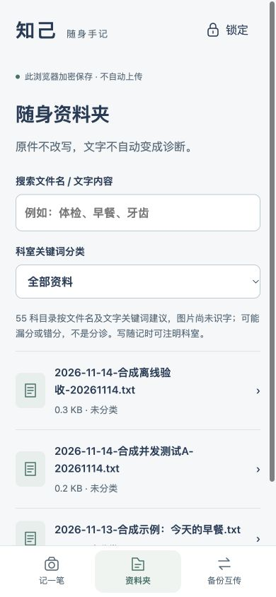

# 1.2.1 全量回归与补充验收

日期：2026-11-14。版本：1.2.1。桌面 schema v2，手机加密/互传 schema v1，未更改密码学参数。仅使用临时合成档案、合成附件和模拟模型，不触碰用户已有数据。

## 结论

**本轮全量自动化 218 个不同测试通过：132 Python + 86 Node。** Python 3.9.6 和 3.12.14 各运行完整套件，不把重复运行计入新增测试。基线 189 项通过后增加 29 项，其中边界回归先复现失败，再修复并重跑。Node 为 25.6.0；CI 配置 Node 22 与多版本 Python，本地结果不等于已运行远端 CI。

本轮进一步实测了停服离线重开、真实浏览器双窗口版本冲突和后台模型结果切页保护。**不是零 Bug 保证、医学有效性证明、渗透测试或密码学审计。仍是开发预览，不是完整自动同步产品。**

## 自动化结果

| 套件 | 最终结果 | 说明 |
| --- | --- | --- |
| Python 3.9 全量 | 132/132，15.130 秒 | HTTP、防跨站、SQLite、恢复、外发授权、营养限制、原件互传等 |
| Python 3.12 全量 | 132/132，15.199 秒 | 同一套件的解释器兼容性复验 |
| Node 全量 | 86/86，1.230 秒 | 页面状态、渲染、加密、IDB 适配器与跨语言协议 |
| 5 个 JS 文件语法 | 通过 | app、phone、core、db、sw |
| 下载备份独立解密 | 通过 | 最终浏览器下载产物解出 3 份合成原件，包含停服后创建的随记，全部哈希通过 |

第一次 Python 调用因执行沙箱禁止监听回环端口产生 26 个权限错误；获准在临时目录运行本机 HTTP 测试后，基线及最终全量均通过。这不是隐藏失败或跳过测试。

新增覆盖：

- 手机 3 页/错误 hash、弹窗或保存时的返回导航、异步防重入、已禁用控件不被误启用。
- 加密失败不写库；事务失败/旧窗口冲突不替换本地快照，输入及待合并内容保留。
- 随记来源免责声明、重复提交/幂等保存、非法日期、未来日期和无效 Unicode。
- 多文件部分成功、失败重试不重复、限额前拒绝读取、锁定后的迟到文件选择。
- 锁定清理明文引用与预览 URL，后台恢复后的超时检查，保存中不打断。
- 加密备份解密/预览/确认分离，错误密码可重试，合并不更换本机密钥。
- 未完成原件队列、待确认合并的离页保护，已完成队列不误报警；导出链接与撤销生命周期。
- HTML 样式文本作为纯文字显示；异常旧文件名备份仍可解锁，不放宽路径/类型/哈希检查。
- 真正运行 JavaScript → Python 临时 SQLite → JavaScript 往返：UTF-8 BOM、中文/emoji、同名异内容、JPG/PNG/PDF 签名字节、重复导入和共同拒绝的畸形输入。签名样本用于协议校验，不宣称是完整可读图片或 PDF。

`web-phone-state.test.cjs` 用 VM/事件夹具执行生产脚本，存储和加密以确定性替身隔离；不把它当作真实 DOM、系统文件选择器或 Web Crypto 验证。真实密码学另由 core 测试与浏览器下载解密验证。

## 实际发现并修复

1. 手机把名为 `txt` 的无扩展名文件当成 TXT，电脑却拒绝。修复新导入规则，并对旧的已认证加密备份做有限名称兼容，防止升级后自己的旧资料打不开。
2. 电脑互传接受包含制表符等控制字符的文件名，而手机拒绝。互传格式现在拒绝这类名称；导出时只整理包内名称，不改原始字节、桌面数据库、已有完整 ZIP 规则。补充 C1/BOM 边界与跨运行时断言。
3. 手机 `beforeunload` 仅保护随记/正在保存，没保护已选文件及待确认合并。已补齐；移动系统仍不保证该事件一定触发，超时锁定仍会丢弃未保存内容。

## 浏览器闭环

使用内置浏览器的独立 `127.0.0.1:8767` 来源；真实浏览器 IndexedDB/Web Crypto，不是操作用户的 8765/8768 演示页。

| 流程 | 观察结果 |
| --- | --- |
| 真实双窗口版本竞争 | A/B 解锁相同版本；A 保存后 B 写入被拒绝，旧窗口的输入仍在，A 原件未被覆盖 |
| 无清库升级 | 关闭旧窗口，新 Service Worker 接管后看到 1.2.1；旧密码可解锁原有合成资料 |
| 停服后刷新 | 停止 8767 服务，刷新带 `#backup` 的页面仍显示锁定页，成功解锁并导航 |
| 停服后新增和重开 | 离线保存合成 TXT 后，关闭全部测试标签再新建页面，解锁后新增原件仍在 |
| 离线导出 | 加密准备完成，真实“保存文件”链接下载成功；独立 Node 解密得到全部 3 份原件 |
| 手机页面尺寸 | 3 页 × 320/390/768 像素，9 次测量均 `scrollWidth === innerWidth` |
| 桌面导航 | 11 页 × 320/1280 像素，22 次测量没有页面级横向溢出；窄屏通过“更多”菜单到全部页 |
| 模型结果迟到 | 仅模拟服务，延迟 6 秒；1.4 秒内完成确认/切设置页/输入。模型完成提示出现后，页仍是设置，输入和 dirty 标记不变；回助理页看到草稿已保存 |
| 桌面控制台 | 本次测试标签检查未见 warn/error |

停服测试证实当前浏览器已安装缓存的离线打开能力，**没有切换整台电脑网络、没有退出整个浏览器进程，也不代表 iPhone/Android 所有版本均通过**。不把上一轮未通过的离线验收追溯改写为成功。



其他证据：[双窗口拒绝覆盖](screenshots/concurrency-v1.2.1.jpg)、[异步完成不覆盖输入](screenshots/async-v1.2.1.jpg)。这些都是桌面浏览器测试截图，不是物理手机截图。

## 交付包复验

- 在临时干净目录构建 `dist/health_journal_local-1.2.1-py3-none-any.whl`，27 个运行时文件与源码逐字节一致。
- Wheel 解包到独立临时目录，隔离 Python 导入路径启动回环 HTTP 服务；桌面页、手机页、脚本、MIT 许可、55 科目录及静态导出全部通过。不是只在源码目录运行的冒烟测试。
- `dist/phone-1.2.1/` 共 11 个纯静态文件，资源与源码一致；同时提供 `dist/phone-1.2.1-static.zip`。SHA-256 见 `dist/SHA256SUMS`。
- 25 份打包文档/图片与源码一致，17 份 Markdown 的相对链接存在性检查通过。包内未发现个人数据库、加密备份、互传文件或本地演示目录。
- `.local-*`、`dist/`、`.hjvault`、`.hj-transfer.json` 均被 Git 忽略。本轮未 commit、push 或更改已有用户服务；临时测试服务已停止。
- 构建器对旧式 `project.license` TOML 表给出弃用警告，当前构建成功、MIT 文本正常打包；后续构建工具升级前需迁移元数据写法，不把这个警告掩盖成无告警构建。

## 尚未完成的门禁

- **物理 iPhone/Android**：相机权限、拍摄取消、系统相册/文件提供者、HEIC、低内存大图、软键盘、安装与主屏幕隔离行为。
- **系统文件选择器恢复闭环**：上一轮内置选择器调用长时间卡住，本轮没有重复无界等待。解密/合并/事务及 UI 事件测试通过，但不宣称用户从系统文件入口到最终恢复的真机流程已经通过。
- 外部渗透测试/密码学审计、临床有效性与法规认证、真实云模型输出质量/费用验证。
- 自动联网多端同步、账号/配对/中继、删除传播、手机全临床记录与模型功能没有实现。

真资料投入前，应在自己的手机上用合成文件完成“相机或文件导入 → 关闭重开 → 导出系统文件 → 另一设备选择文件并解密恢复”。资料必须另有受控备份。

## 复现

```bash
python3 -m unittest discover -s tests -q
node --check health_journal/web/app.js
node --check health_journal/web/phone/phone.js
node --check health_journal/web/phone/core.js
node --check health_journal/web/phone/db.js
node --check health_journal/web/phone/sw.js
node --test tests/web*.test.cjs
python3 -m tests.browser_fixture
python3 -m health_journal.export_phone --output dist/phone-1.2.1
```

Node 跨语言测试需要 `python3`；可设置 `PYTHON` 指向其他 Python 可执行文件。CI web 作业已显式安装 Python 3.12。浏览器夹具使用临时合成库；设置 `HEALTH_FIXTURE_DELAY=6` 可复现迟到结果测试，退出即清理该临时库。新静态目录必须不存在，升级不得清理站点数据。
