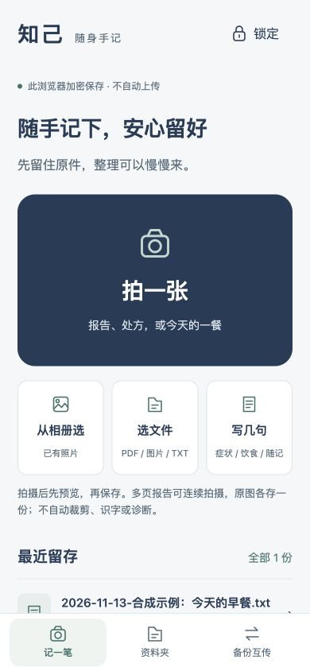

# 1.2.0 手机资料版验收

日期：2026-11-13 至 2026-11-14。版本：1.2.0。桌面数据库/ZIP schema 仍为 v2；手机加密格式与原件互传格式分别为 v1。

此为历史报告。1.2.1 已进一步通过真实浏览器离线重开和双窗口测试，最新结果与仍未完成项见 [1.2.1 验收报告](ACCEPTANCE-v1.2.1.md)，不以新结果改写本次历史结论。

## 结论

完成手机优先资料界面、本地加密快照、加密备份导出、原件互传协议、桌面导入改进与移动导航。**当前仍是开发预览，不是自动同步产品，也没有完成全部 iPhone/Android 真机验收。** 不声称零 Bug、临床准确性或外部安全认证。

最新自动化回归共 **189 个不同测试通过：129 Python + 60 Node**。Python 套件分别在 3.12.14 和 3.9.6 运行均通过，不把不同解释器重复运行计作新增测试。Node 使用 25.6.0；CI 配置使用 22，但本次没有实际运行 GitHub Actions。

## 本次实测

| 检查 | 结果 |
| --- | --- |
| Python 3.12 完整 unittest | 129/129，15.032 秒 |
| Python 3.9 完整 unittest | 129/129，14.826 秒 |
| Node 完整前端/加密测试 | 60/60，最终 0.702 秒 |
| app / phone / core / db / sw 语法 | `node --check` 通过 |
| 手机创建合成档案、保存 TXT 随记 | 浏览器实际操作通过，列表出现原件 |
| 关闭随记时保留输入 | 页内提示出现，“继续编辑”后成功保存 |
| 锁定、错误密码、正确密码 | 通过；错误密码不打开档案，正确密码保留原件 |
| 刷新、关闭测试页后重新打开 | 联网条件下通过；仍可解锁原有合成原件 |
| 加密备份实际下载 | 改用“准备文件 → 保存文件”链接，通过浏览器下载接口得到 `.hjvault`；独立 Node 解密后确认 1 份原件及文件名 |
| 手机 390×844 页面 | 首页/资料页截图检查；资料页 `scrollWidth === innerWidth === 390` |
| 桌面 11 页手机导航 | 390×844，逐项“更多”导航与 h1 核对；11 页 document 宽度均为 390，没有页面级横向溢出 |
| 桌面页内未保存确认 | 实际显示继续/放弃，不用原生 confirm；确认放弃后进入时间线 |
| 桌面粘贴文字导入 | 保存合成 TXT，资料数增加、显示口腔科待核对建议 |
| 手机其他窗口覆盖保护 | IndexedDB 适配器事务模型测试覆盖旧版本、创建竞争、提交中止；不是多真机并发验收 |
| 资料包往返、重复与错误 | Python/Node 验证：哈希、MIME、大小、未知字段、重复、同名异内容及失败回滚 |
| 静态导出器 | 临时目录只包含明确允许资源、MIT 许可和 55 科目录；已有目录拒绝覆盖 |

使用独立临时合成库及明确标记的合成早餐文字，没有使用真实医疗档案或实际模型服务。临时模拟模型服务器已停止；原来的用户档案服务及目录未用于写入测试。

## 代码审查重点与修正

- `core.js`：白名单交换格式、规范 Base64、UTF-8/签名、20/40 MB 限额、500 份上限、SHA-256、保留双方原件。大 Base64 避免递归式重复正则，覆盖多 MB 输入。
- 加密：标准 Web Crypto，PBKDF2-SHA256 600000 次、随机盐/IV、AES-GCM 认证头、固定算法参数及认证标签。测试密码错误、密文/盐篡改、参数降级与密钥不可提取。未以此代替密码学审计。
- `db.js`：加密后才写 IndexedDB；事务内核对版本。冲突/配额式中止不替换先前快照；阻塞升级后迟到的连接会关闭。
- `phone.js`：文字转义、危险附件不嵌入执行、PDF 只下载；保存按钮防重入；隐私/未保存输入提示；锁定清理明文引用。不将原件自动升级为病历事实。
- 手机导出改为准备完成后提供真正的 `download` 链接，避免加密异步等待后程序化点击导致移动浏览器丢失用户手势。页面明确“准备完成不等于已备份”。
- `sw.js`：只缓存精确静态列表，URL 比较前去掉 hash，覆盖 `#capture/#library/#backup`；不拦截 API、其他来源或未知 query。旧窗口不会被强制更新。
- `transfer.py` / `Store.merge_documents`：整体校验、事务新增、重复内容保留已有名称/分类；磁盘失败/已有原件损坏回滚本次新增。资料包不含桌面临床记录、AI 或 Key。
- `server.py`：新增 API 仍要求回环地址/同源令牌/显式确认，JSON Content-Type，拒绝重复确认头；没有开放 LAN/CORS。手机静态页面不含会话令牌。
- 桌面移动页：底部核心导航和全部功能菜单；废弃旧表单后先恢复已保存状态，避免关闭导入/更多菜单后残留“已放弃但仍显示”的旧输入；有专项回归测试。
- 手机隐藏文件 input 增加显式 `[hidden]` 规则，防止通用输入样式让隐形选择器意外显示；输入字体 16 px、触控区域和安全边距。
- 打包/文档：版本、隐私、免责声明和 MIT 许可区分桌面与手机存储；`.hjvault` / `.hj-transfer.json` 默认忽略；纯静态产物保留 MIT 文本。

## 尚未通过或尚未执行

1. **真实 iPhone/Android**：后置相机权限、相册/文件提供者、多选、拍摄取消、HEIC 导出、低内存大照片、键盘顶起、主屏幕安装与图标支持。
2. **手机文件选择器恢复闭环**：当前内置浏览器选择器调用长时间未完成，返回时已触发空闲锁定，故未取得最终 UI 合并结果。格式/密码/合并/事务测试通过，不冒充真实选择器恢复已经通过。
3. **实际断网重开**：停掉测试服务后，内置浏览器进入连接失败页，未完成离线解锁验收。随后补充了 hash 规范化和模拟 Service Worker 回归；最终版本仍需独立 Safari/Chrome 真机断网验证。缓存就绪提示不是实测离线保证。
4. **自动同步与功能对齐**：没有账号、配对、中继、端到端联网同步、删除传播、临床记录冲突合并、手机端 AI 或 API Key 管理。原件互传不等于全病历同步。
5. **安全/医疗验证**：未做外部密码学审计、渗透测试、法规认证、临床验证或真实云模型准确率/计费测试。
6. **上一轮遗留门禁**：本轮补验了页内离开确认与移动路由，但没有把后台模型分析切页、所有独立浏览器/系统的 E2E 门禁统称为全部完成。

使用真资料前，必须在自己的手机上用合成内容完成“导入 → 关闭重开 → 导出到文件 → 另一设备解密恢复”，并留有应用之外的可靠原件。检查表见 [发布清单](RELEASING.md)。

## 截图

以下为当前实现的 **390×844 桌面浏览器移动视口**，不是物理手机截图；条目为合成测试。



## 复现命令

```bash
python3 -m unittest discover -s tests -q
node --check health_journal/web/app.js
node --check health_journal/web/phone/phone.js
node --check health_journal/web/phone/core.js
node --check health_journal/web/phone/db.js
node --check health_journal/web/phone/sw.js
node --test tests/web*.test.cjs
python3 -m health_journal.export_phone --output dist/phone-1.2.0
```

安装、数据流、合并边界和下一阶段自动同步设计见 [MOBILE.md](MOBILE.md)。历史完整系统审查见 [1.1.1 报告](AUDIT-2026-11-13.md)。
